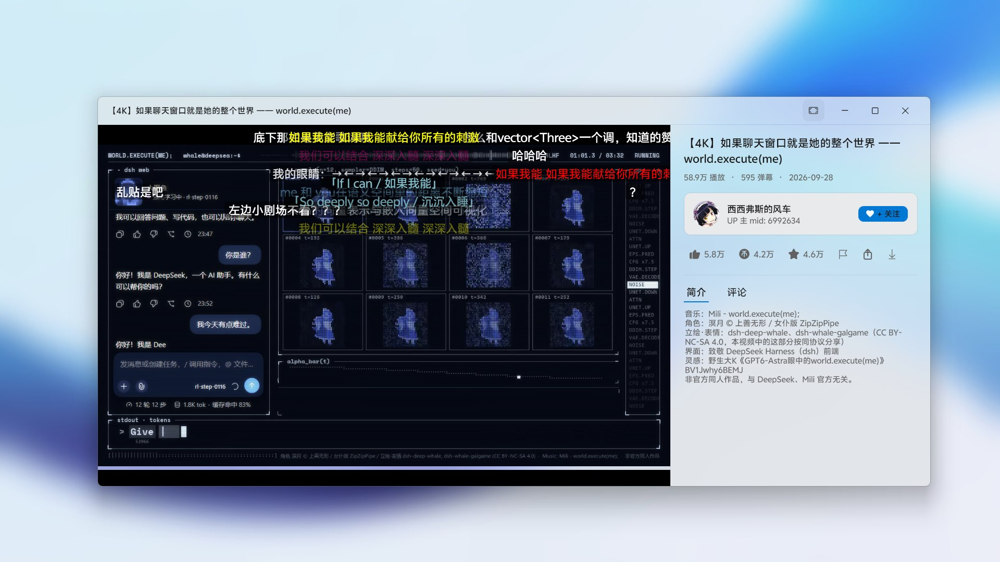

# BiliDesk

哔哩哔哩第三方桌面客户端（Windows / WPF / .NET 8）。




> 非官方、非商业的开源项目，与哔哩哔哩官方无任何关联。视频内容与版权归哔哩哔哩所有。

## 下载

前往 [Releases](https://github.com/ABING1111/BiliDesk/releases/latest) 下载最新版本：

- **便携版 zip** —— 自包含，解压即用，不需要安装 .NET 运行时
- **安装器** —— 需要 .NET 8 或更高版本的桌面运行时（安装器会自动检测并引导下载；只装了 .NET 10/11 也可以直接用）

## 功能

- 视频播放：LibVLC 内核，DASH 音视频双流，最高 4K，HEVC 优先选流
- 播放设置：默认画质可预选（该清晰度不可用时自动降级），默认音量可预设（播放中调节后自动记忆），线路自动测速/手动指定，免登录 1080P
- 多窗口播放：可同时打开多个播放器窗口，正在看的视频不会被新打开的视频覆盖（设置里可关）
- 播放器窗口尺寸记忆：上次普通模式拖成多大，下次打开就是多大（只记大小不记位置；多窗口下只认当前活跃的那个窗口）
- 播放器视图：视频可「铺满窗口」（收起右侧信息栏），另有全屏（F / 双击视频）
- 弹幕：滚动/顶部/底部全类型渲染，智能屏蔽、关键词黑名单、彩色开关、显示区域调节；黑边描边（同一份文字几何的填充 + 1px 黑色描边，不是叠两层字重，白底画面也看得清且不会错影），按「文字 + 字体 + 字号 + 缩放」缓存几何、逐帧只改位置；推进时钟带倍速外推，倍速切换先结算旧时钟、缓冲冻结、跳转重置
- 短视频本地合流：≤3 分钟的视频下载 1080P DASH 后本地合流为 MP4 缓存播放
- SponsorBlock 跳过赞助片段（默认关闭，需用户手动开启）
- 登录（扫码）、历史/收藏/稍后再看/动态/消息、分区浏览、搜索
- 个人中心：动态/关注/粉丝均可点开二级页查看。关注与粉丝共用一个关系页，页内可用「关注 / 粉丝」分段控件直接互切，支持滚动翻页、打开 UP 主页、查看/下载头像、右键取消关注（仅关注模式），并标注互相关注关系
  - **请求按坐标冻结**：切模式 / 切分组 / 换账号 / 刷新都会让在飞的那一轮作废并被取消，旧响应改不动当前列表（旧关注分页混进粉丝列表这类问题由此根除）
  - **分组按账号归属**：退出登录即清空分组与计数，换账号不保留上一个账号的 tagid
  - **计数分家**：全量关注数、当前分组人数、已加载数、匹配数各自独立，选中三人组就显示 3 而不是 652
  - **搜索**：300ms 防抖 + 输入法组合期间暂停；可搜昵称 / mid / 签名；每批最多自动续翻 5 页、页间至少 300ms，**即使已有命中也跑完本批**；没搜完会说明范围并给「继续搜索」
  - **翻页失败不冒充到底**：保留已加载的列表与待重试页码，尾部给「重试」；只有真的取完才显示「已经到底啦」
  - **行虚拟化卡片墙**：按实际内容宽度算 1~4 列（最低卡宽 240），离屏整行回收，652 人与 100 人的控件数几乎一样；卡片高固定 88，签名/认证在数据层归一成单行（完整原文进 ToolTip）
  - 右下角常驻**圆形**悬浮返回（与播放器评论区返回同款样式，不占固定空白行）；卡片支持回车打开，分组支持 ↑/↓；搜索时 Esc 先清搜索，输入法组合期间 Esc 不翻页；Esc 退出顺序为退全屏 → 收详情栏 → 返一级评论 → 关播放器
- 亮色/暗色/跟随系统三态主题，托盘常驻，自动检查更新

## 构建

需要 Windows 10+ 和 .NET 8 SDK（x64）。

```powershell
dotnet build BiliDesk/BiliDesk.csproj -c Release
```

LibVLC 原生库由 NuGet 包（`VideoLAN.LibVLC.Windows`）自动部署，无需手动安装。

完整发布用仓库根目录的 `发布.ps1`：

```powershell
powershell -ExecutionPolicy Bypass -File 发布.ps1
```

它会**从 `BiliDesk/BiliDesk.csproj` 的 `<Version>` 读版本号**（不要再在脚本里单独改一遍），
并把产物放进带版本号的独立目录，避免上一版残留的文件混进新包：

```
Publish/BiliDesk-<ver>-portable/            自包含单文件(中间产物)
Publish/BiliDesk-<ver>-portable.zip         便携版
Publish/BiliDesk-<ver>-installer/installer.iss
Publish/BiliDesk-<ver>-installer/files/     安装器载荷(框架依赖)
Publish/BiliDesk-<ver>-installer/BiliDesk-<ver>-setup.exe   (用 Inno Setup 6 编译上面的 .iss)
```

升版本只需要改 `BiliDesk/BiliDesk.csproj` 一处的 `<Version>`。

## 许可

[GPL-3.0](LICENSE)
